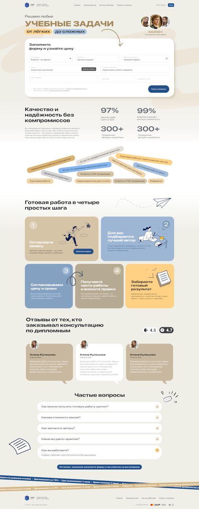
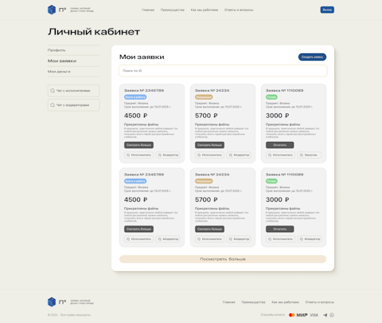
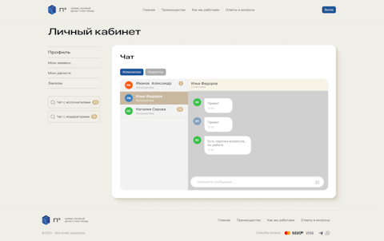

***p3-app-showcasse***

#"П3 ресурс" ("Cервис, который делает учёбу проще")*

## Задача: реализовать быстрое и динамичное приложение с возможностью дальнейшего масштабирования.

*Примеры исходных макетов с которых верстался сайт*

| Главная | ЛК Пользователя | Чат Пользователя |
| -- | -- | -- |
|  |  |  |

1. Стек CSS3, Alpine.js, Livewire, Laravel.
2. Адаптивная верстка Laravel Blade и CSS3.
3. Отзывчивый UI Alpine.js и Laravel Livewire.
4. Бекэнд Laravel (Eloquent, MySQL).
